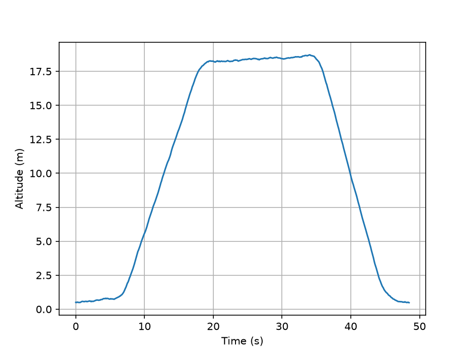

# Flight Computer

A barometric altimeter in C on a Raspberry Pi Pico 2, with the sensor driver written from the datasheet (no libraries).



Elevator test, floors 2 to 8 and back down. Tracked ~18 m (≈3 m per floor) and returned to within ~10 cm of the start.

## Hardware

- Raspberry Pi Pico 2
- BMP388 pressure/temperature sensor (I2C, address 0x77)
- Breadboard and jumper wires

| BMP388 | Pico 2 |
|---|---|
| VIN | 3V3 OUT (pin 36) |
| GND | GND (pin 38) |
| SCL | GP5 (pin 7) |
| SDA | GP4 (pin 6) |

## How it works

1. Read raw pressure and temperature over I2C
2. Read the BMP388's 21 bytes of factory calibration
3. Compensate temperature first, then pressure corrected for temperature
4. Convert pressure to altitude relative to the startup pressure ("ground")
5. Smooth with an exponential moving average
6. Stream CSV over USB, then log and plot it in Python

## What I learned / design decisions

- The raw pressure reading can't be trusted on its own, because it drifts with temperature. The chip's factory calibration corrects it.
- When gluing a signed 2-byte value, I combine the bytes as unsigned first, then cast the full 16 bits to signed. If a byte is made signed before gluing, C fills the bits above it with 1s to keep it negative, and those 1s overwrite the high byte.
- The first readings after power-up are junk, so I wait for the sensor to start measuring and skip impossible altitudes.
- I log raw data alongside the smoothed altitude, so a run can be reprocessed if the smoothing goes wrong. One early run's smoothing got stuck at −3 × 10¹⁵¹ m because of a single bad startup reading.

## Build and run

**Requirements:** the hardware above, VS Code with the official Raspberry Pi Pico extension, and Python 3 with `pip3 install pyserial matplotlib`.

**Compile**
1. Open the `Altimeter` folder in VS Code.
2. Click **Compile** in the bottom bar. This produces `build/Altimeter.uf2`.

**Flash**
1. Hold **BOOTSEL** while plugging the Pico into USB. It mounts as a drive called `RP2350`.
2. Drag `build/Altimeter.uf2` onto that drive. The Pico reboots and runs.

**View live output**
```
screen $(ls /dev/tty.usbmodem* | head -1) 115200
```
Exit with Ctrl+A, then K, then Y.

**Record and plot**
```
python3 tools/logger.py              # records to a CSV named with the current date/time
python3 tools/plot.py <logname>.csv  # plots altitude vs time, can save as PNG
```
Close `screen` before using the logger. Only one program can use the serial port at a time.

## Roadmap

- [x] I2C driver for the BMP388, written from the datasheet (chip ID, register read/write)
- [x] Factory calibration and temperature-compensated pressure
- [x] Pressure to altitude relative to a startup ground reference
- [x] Smoothing (exponential moving average) and a startup junk-reading guard
- [x] Python serial logger and plotter
- [x] Elevator test: tracked 6 floors (~18 m), returned to within ~10 cm
- [ ] Flight state machine: PAD → ASCENT → APOGEE → DESCENT → LANDED, with touchdown timestamp
- [ ] Continuously update the ground reference on the pad, to cancel barometric drift
- [ ] Log to onboard flash, so it records with no laptop attached
- [ ] Battery power for untethered flights
- [ ] Add an accelerometer and combine it with the barometer (sensor fusion)
- [ ] Custom PCB designed in KiCad
- [ ] Real flight test (drone or rocket) with plotted flight data